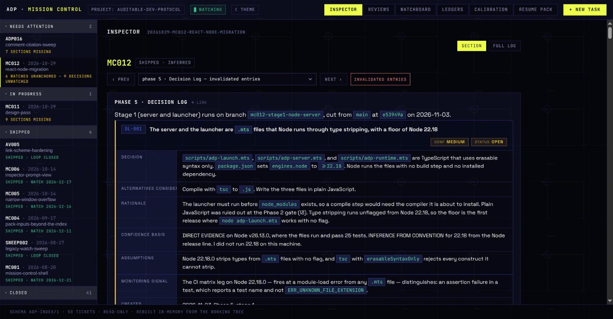
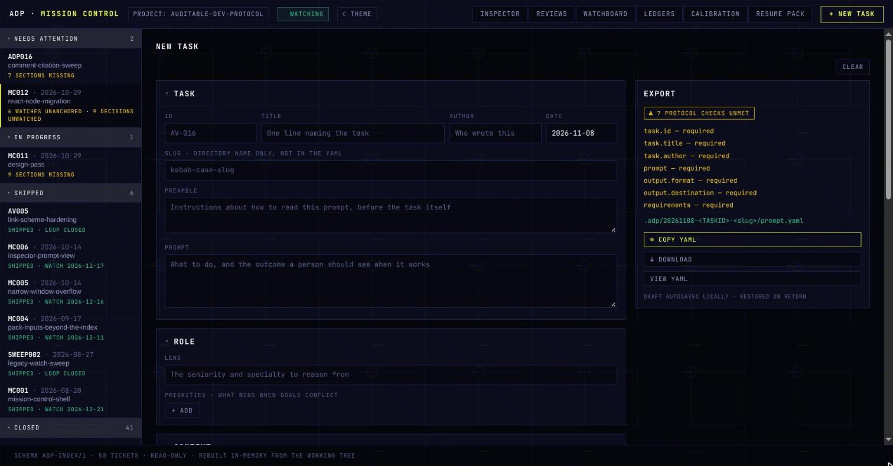

<div align="center">
  <h1>Auditable AI-Assisted Development Protocol</h1>
  <p><strong>A structured operating system for defensible AI-assisted engineering work.</strong></p>
  <p>
    
    
    
    
  </p>
  <p>
    
    
  </p>
</div>

A nine-phase protocol for AI-assisted development. The model defends one recommendation, logs every assumption with a confidence level, and leaves artifacts you can audit later. Use it on work that is hard to reverse, where defensibility matters more than speed.

## What's inside

- `SKILL.md`: the full protocol, its phase gates, and the artifact each phase produces.
- `prompts/prompt-template.yaml`: a YAML format for framing a request before you start. Copy it and fill it in.
- `references/prompt-template-annotated.yaml`: the same template with every field and option documented.
- `references/failure-modes.md`: maps a symptom to the artifact you open first when something breaks.
- `scripts/validate-prompt.mts`: checks a filled prompt for structure, types, and allowed values.
- `scripts/app.html` and `src/app/`: mission control, the browser app that watches every audit log in the repo and builds new prompts. This is the protocol's observability layer.
- `src/lib/`: the typed libraries the app, the validator, and the tests share.
- `scripts/adp-launch.mts`: prints the URL of mission control for the current repo, starting its localhost server (`scripts/adp-server.mts`) when none is live. Run it with `npm start` or `node scripts/adp-launch.mts`. It needs Node 22.18 or later.
- `packs/`: the resume packs mission control fills from the corpus index, one `.pack.md` per pack. Drop a file in to add one.

## Using the protocol

Invoke the skill by name, or ask for any of its artifacts. Reach for it before migrations, auth changes, payments, destructive operations, or public API changes. Skip it for renames and one-liners.

Every run writes its artifacts to `.adp/<task-id>/` at the project root: the audit log at `.adp/<task-id>/audit-log.md`, plus any prompt drafted in session. The skill opens mission control on the repo and keeps session output to questions, so you watch the run there rather than in the chat. Whether `.adp/` gets committed or gitignored is your call; the skill asks once if the project hasn't decided.

The YAML prompt template is the preferred way to frame a request, but the skill accepts any prompting method you choose.

## Using the prompt template

1. Copy `prompts/prompt-template.yaml` to `.adp/<task-id>/prompt.yaml` in your project.
2. Fill in the role, the ask, the constraints, the context, the output, and the requirements. Delete the sections you do not need.
3. Set `protocol.artifacts` to the documents you want produced. The annotated reference lists every option.
4. Validate it:

   ```
   node scripts/validate-prompt.mts your-prompt.yaml
   ```

   The script prints each problem it finds and exits non-zero. A clean run prints `VALID`.

Invoke the skill with a request in hand and it offers to draft a filled template from what you gave it, saved to `.adp/<task-id>/prompt.yaml`.

## Mission control

Mission control is the one browser UI. Run `npm start` or `node scripts/adp-launch.mts` from the repo you work in, and open the URL it prints. The first launch installs the dependencies and builds the app into `dist/`. A later launch rebuilds only when a source changed, and it reuses the server that is already live for the repo.

Mission control reads logs and prompts from the repo's `.adp/` directory and nothing else. It has no file picker, no paste field, and no drop target. Each screen re-renders when a file under `.adp/` changes.

- **Inspector** renders a ticket's audit log by section, or in full, and shows its `prompt.yaml`.
- **Reviews** shows the PR review rounds the `prreview` skill wrote for a ticket.
- **Watchboard**, **Ledgers**, and **Calibration** show the open watches, the decisions, and the confidence record across every ticket.
- **Resume pack** fills a pack from `packs/` with a ticket's state, ready to paste into a new session.
- **New task** fills the prompt template through a form, checks it as you type, and copies or downloads the YAML. "Start from this prompt" on a ticket's prompt view loads that ticket's `prompt.yaml` into the form.
