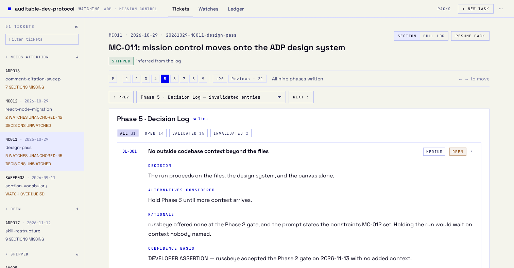
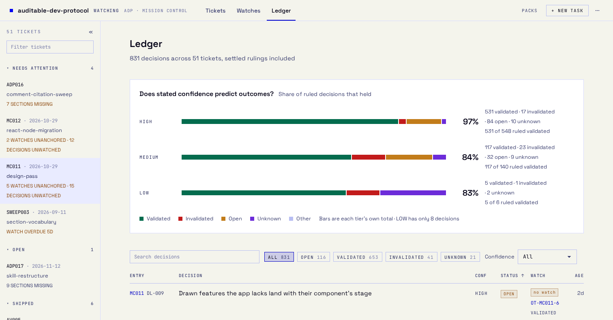

<div align="center">
  <h1>Auditable AI-Assisted Development Protocol</h1>
  <p><strong>Make your AI coding assistant show its work, stand behind it, and come back to check it.</strong></p>
  <p>
    
    
    
    
  </p>
  <p>
    
    
  </p>
</div>

The Auditable Development Protocol (ADP) is a skill for [Claude Code](https://code.claude.com/docs/en/overview). It turns a coding task into a short, structured run. Claude explains the problem back to you, commits to one approach, writes down every decision and how sure it is, and books a date to check each guess it could not prove. All of it lands in one Markdown file per task, and a local web app, mission control, shows you every task, every open check, and how often Claude's confidence turned out to be right.

## The problem

An AI assistant writes code that looks right. That is what it is trained to do. It has no reputation to protect and no on-call shift, so being confidently wrong costs it nothing. Three things follow:

- **The reasoning disappears.** Why Claude chose this design lives in a chat. A week later the chat is gone, and the code is all that is left.
- **Guesses ship as facts.** Claude assumes the table is small, the API never returns null, the users all run a recent browser. It rarely says so, and nobody writes the guess down.
- **Nobody checks back.** Even when someone does notice a guess, there is no date to verify it on. The guess becomes the system's behavior by default.

Prompting harder or reviewing more does not fix this. A reviewer sees the diff, not the guesses behind it. A tests-pass result says the code does what the tests ask, not that the tests ask the right thing.

## The approach

ADP gives Claude the stake it lacks. It works through nine phases, and you can stop it at the end of any of them:

1. **Restate the problem** and what done looks like, before any plan.
2. **List what is known**, what is inferred, and what nobody can tell yet.
3. **Recommend one approach** and defend it against the alternatives. No menus, no "it depends".
4. **Imagine it failed** six months from now, and list the likely causes.
5. **Build it**, logging every real decision as it is made.
6. **Attack the tests**: what could pass and still be wrong.
7. **Summarize the change** with a confidence level on each claim.
8. **State the deployment risk**: what to watch and when to roll back.
9. **Book the follow-ups**: each unproven assumption becomes a dated check.

Each stop is a **gate**. Claude asks you one question and waits. You confirm, correct, or push back, and nothing moves on until the open items are settled.

Three habits make the record worth reading later:

- **Every decision carries a confidence word**, HIGH, MEDIUM, or LOW, plus where the confidence comes from: Claude saw it in the code, inferred it from how the codebase usually works, or took your word for it. Those are different claims, and the log keeps them apart.
- **Every guess gets a watch.** A watch is a follow-up check with a question, a pass-or-fail condition, and a date. "The import job stays under 10 minutes on production data. Check on 2026-12-14." When the date comes, someone answers it, and the result goes in the log.
- **The log is append-only.** Nothing is edited after the fact. A correction is a new line that says what changed and why, so the history stays honest.

You get a run that a reviewer, or you in six months, can audit against what actually happened.

## Install

You need Claude Code, `git`, and Node.js 22.18 or later.

- **For all your projects:** clone the skill into your user skills folder.

  ```bash
  git clone https://github.com/russbeye/auditable-dev-protocol.git ~/.claude/skills/auditable-dev-protocol
  ```

- **For one project only:** clone it into `.claude/skills/auditable-dev-protocol` inside that project.

The skill is ready in the next Claude Code session you start. To update it, run `git -C ~/.claude/skills/auditable-dev-protocol pull`.

The commands in this README use the user-level path. For a per-project install, run them from the project root and replace `~/.claude/skills/` with `.claude/skills/`. For example, `git -C .claude/skills/auditable-dev-protocol pull`.

**Optional:** install [prreview](https://github.com/russbeye/prreview), the sister skill that reviews a pull request and files the review beside the task. Mission control's Reviews screen shows what it writes.

## Use it

Start Claude Code in your project and ask for the protocol by name, or type the slash command:

```
/auditable-dev-protocol add rate limiting to the login endpoint
```

Claude also offers the protocol on its own before risky work, such as a database migration, an auth change, payments, or a destructive operation. It skips the protocol for renames and one-line fixes.

What happens next:

1. Claude creates `.adp/<task-id>/audit-log.md` at your project root. Every artifact of the run is written there, in full, the moment it exists.
2. Claude opens mission control in your browser. Pick the task in the left rail and read the run there, not in the chat. The chat holds only the gate questions.
3. At each gate, Claude names what is still open and asks you one question. Answer it, and Claude moves to the next phase.

Whether you commit `.adp/` or gitignore it is your call. Committing keeps the record with the code. Ignoring it keeps it local. Claude asks once if your project has not decided.

### Frame a task with the prompt template

You can start from a plain request. For a bigger task, a filled template gets Claude to the first gate with less back-and-forth:

1. Copy `prompts/prompt-template.yaml` to `.adp/<task-id>/prompt.yaml`.
2. Fill in the role, the ask, the constraints, the context, and the requirements that define done. Delete what you do not need.
3. Check it:

   ```bash
   node ~/.claude/skills/auditable-dev-protocol/scripts/validate-prompt.mts .adp/<task-id>/prompt.yaml
   ```

   The script lists each problem and exits non-zero, or prints `VALID`.

`references/prompt-template-annotated.yaml` documents every field. Mission control's **New task** form fills the same template for you and checks it as you type.

## Mission control

Mission control is a small web app that runs on your machine. It reads the `.adp/` folder of the repo you launch it from, and it redraws whenever a log changes. It has no upload and no account, and it binds to `127.0.0.1` only.

Claude launches it during a run. To open it yourself, run this from your project root:

```bash
node ~/.claude/skills/auditable-dev-protocol/scripts/adp-launch.mts
```

It prints a URL. The first launch installs the app's dependencies and builds it, which can take a minute. Later launches reuse the server that is already running for that repo.

It has three main views.

### Tickets: one task, in full

A **ticket** is one task: one folder under `.adp/`, one audit log. The left rail lists every ticket, grouped by where it stands: needs attention, open, in review, shipped, and closed. The main pane shows the selected ticket one section at a time, or the whole log at once.

**Why open it.** It answers "why is the code like this?" without the chat. Each decision shows what was chosen, what was rejected and why, how sure Claude was, and what would prove it wrong.

**How to use it:**

- **Start your day at the top of the rail.** "Needs attention" collects the tickets that owe you something, and each one says what: a watch past its date, a decision with no watch behind it, or a phase that was never written.
- **Before you change old code, read its ticket.** The Decision Log tells you which constraints were real and which were guesses. A guess marked LOW is a place to look first.
- **Hand a reviewer the ticket, not just the diff.** The phase strip jumps to the Recommendation Brief or the Pre-Mortem in one click. Once a review round exists, a **Reviews** box at the end of the strip opens the Reviews screen for the ticket.

### Watches: every promise to check back

The Watches view lists every watch across every ticket, with what to check, the ticket it belongs to, its due date, and the days left. Filters split them into overdue, due soon (within 14 days), upcoming, unanchored, and closed.

An **unanchored** watch has a window tied to an event rather than a date, such as "30 days after the merge". It turns into a dated watch once someone records the event's date.

**Why open it.** Watches are where the protocol pays off. A guess that nobody checks is still a guess. This view is the one list of every check your team promised to run, so none of them slips quietly.

**How to use it:**

- **Make it a weekly ritual.** Filter to overdue and due soon, and work the list. Each row says exactly what to look at and what counts as a pass.
- **Close each watch with a result.** Ask Claude to record whether it held up (VALIDATED), failed (INVALIDATED), or could not be told (UNKNOWN). A failed watch is good news caught early: it names the decision to revisit.
- **Anchor event windows when the event happens.** When a merge or a release lands, record its date, and the unanchored watches it was waiting on move onto the calendar.

### Ledger: is the confidence honest?

The Ledger lists every decision on record across every ticket: its confidence, its status, the watch that covers it, and its age. Above the table, a chart answers one question: when Claude said HIGH, how often did the decision hold up? And MEDIUM? And LOW?

**Why open it.** Confidence words mean nothing until they are checked against outcomes. The Ledger checks them. Over time it tells you how far to trust a HIGH, and where your team's guesses tend to go wrong.

**How to use it:**

- **Read the chart before a risky change.** If HIGH holds up 97% of the time and MEDIUM 84%, a MEDIUM call on a migration deserves a closer look before you run it.
- **Sort by status to find the open decisions.** Each open decision is a bet the team has not settled yet. One with no watch beside it is a bet that nobody plans to settle.
- **Search before you decide again.** Search the decisions for the area you are about to change. A past decision that was ruled INVALIDATED is a mistake the team already paid for once.

### The rest

- **Reviews** shows the pull request review rounds that [prreview](https://github.com/russbeye/prreview) wrote for a ticket.
- **Packs** fills a ready-made prompt with the current state of a ticket, or of every ticket, so you can paste it into a fresh Claude session and pick up the work. One pack resumes a single ticket. Others list every watch by due date or every gap the record shows. Each pack is a `.pack.md` file in `packs/`. Add a file to add a pack.
- **New task** fills the prompt template through a form and copies or downloads the YAML.

## Terms

| Term | Meaning |
|------|---------|
| Audit log | The one Markdown file per task, `.adp/<task-id>/audit-log.md`, that holds every artifact of the run |
| Ticket | One task: its folder under `.adp/` and its audit log |
| Gate | The stop at the end of a phase, where Claude asks you one question and waits |
| Decision Log | The running list of decisions in a ticket, each with its alternatives, rationale, and confidence |
| Confidence basis | Where a confidence comes from: direct evidence, inference from convention, or developer assertion |
| Watch | A dated follow-up check on an unproven assumption, also called an obligation ticket |
| Ledger line | An appended line that closes a watch, rules on a decision, or dates an event window |
| Resume pack | A filled prompt that restarts work on a ticket in a new session |

## What's inside

- `SKILL.md`: the full protocol, its gates, and the artifact each phase produces.
- `prompts/prompt-template.yaml`: the YAML template for framing a request.
- `references/prompt-template-annotated.yaml`: the same template with every field and option documented.
- `references/failure-modes.md`: maps a symptom to the artifact to open first when something breaks.
- `scripts/validate-prompt.mts`: checks a filled prompt for structure, types, and allowed values.
- `scripts/adp-launch.mts` and `scripts/adp-server.mts`: the launcher and the localhost server behind mission control. `npm start` runs the launcher too.
- `scripts/app.html` and `src/app/`: mission control itself, a React app.
- `src/lib/`: the typed libraries the app, the validator, and the tests share.
- `packs/`: the resume packs, one `.pack.md` per pack.

## Tests

Run `npm ci` once, then:

- `npm test` runs the library, page, server, and launcher tests under Vitest.
- `npm run typecheck` checks every TypeScript file.
- `npm run test:browser` downloads Chromium, Firefox, and WebKit for Playwright, then runs the browser tests in `scripts/browser/` against a fixture corpus. They check the layout at 720px and 1290px, keyboard order and focus rings, the live region, reduced motion, and the live event stream.

WebKit needs system libraries that Playwright installs only on Ubuntu and Debian. On another Linux, run `npm run test:browser -- --project=chromium --project=firefox`, and let CI run WebKit. To walk your own corpus for unstyled classes, set `ADP_LIVE_ROOT` to the repo root, for example `ADP_LIVE_ROOT=$PWD npm run test:browser -- -g "every class painted"`.

## License

GPL-3.0. See `LICENSE.md`.
